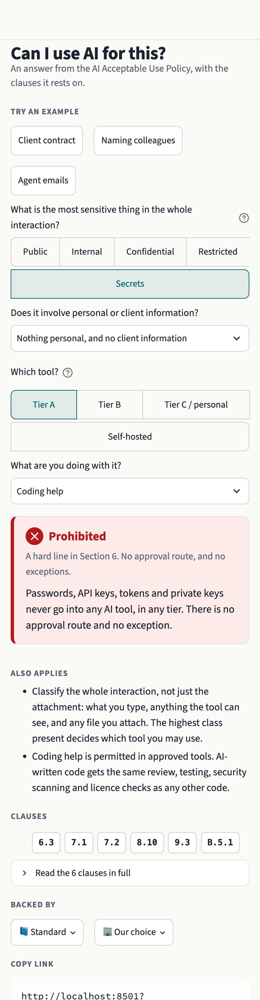
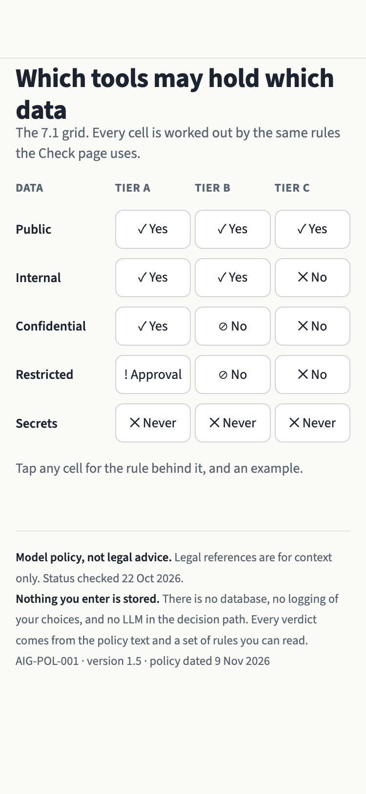
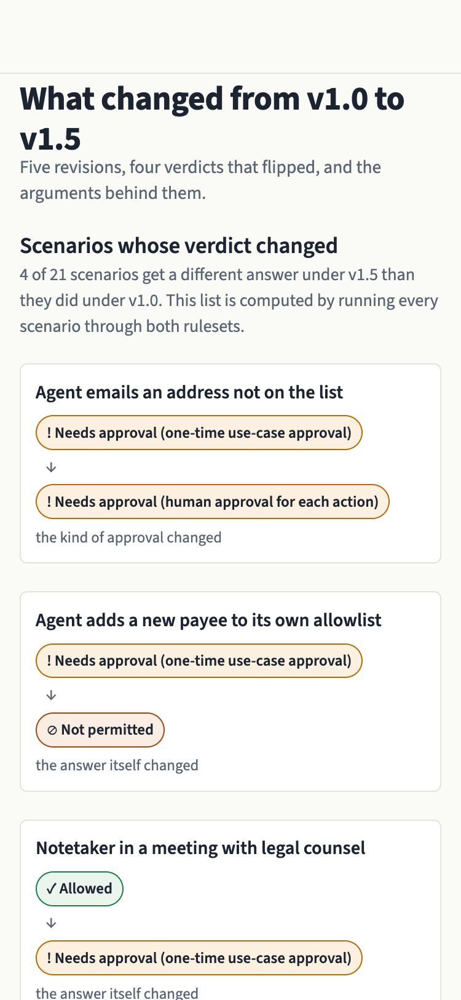
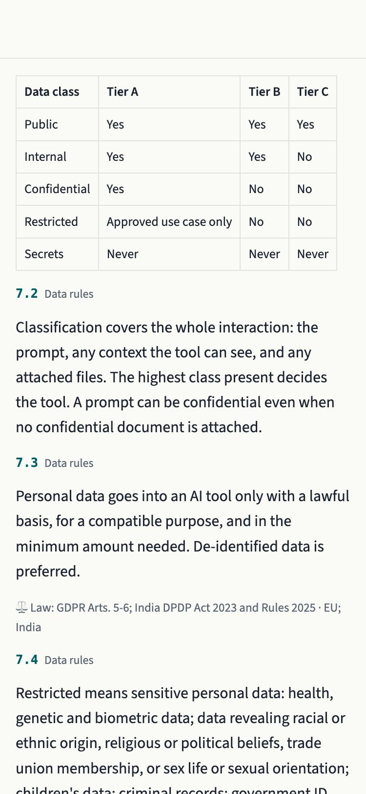

# Can I Use AI For This?

An interactive decision tool built from an AI Acceptable Use Policy
(AIG-POL-001, version 1.6). You pick three things — what data, which tool,
what you're doing — and get an answer, with the clauses it rests on.



---

## What it is

Most AI policies are a PDF nobody opens. This turns one into something you can
answer a question with in about ten seconds, on a phone, and still see exactly
which clause produced the answer.

Four verdicts, and the difference between the middle two is the point:

| | Meaning |
|---|---|
| **Allowed** | Go ahead, and check the output before you rely on it. |
| **Needs approval** | Permitted, once it has been approved and registered. |
| **Not permitted** | Blocked as described — but a compliant route exists, and the card shows it. |
| **Prohibited** | A hard line in Section 6. No approval route, and no exceptions. |

Seven pages: **Check** (the hero), **Matrix** (the data × tier grid),
**Agents** (a permission builder), **Quiz**, **Changes** (two comparisons),
the full **Policy** with search, and **Limits** — what the policy and the tool
do not cover.

## Rules as data, not code

The decision logic lives in YAML, not in Python branches:

```yaml
- id: agent_payment_in_cap_to_allowlisted_payee
  when:
    all_of:
      - { activity: agent }
      - { agent_action: pay }
      - { payee_on_allowlist: true }
      - { within_caps: true }
  then:
    status: NEEDS_APPROVAL
    approval_kind: one_time_use_case
    clauses: ["11.3", "C.2"]
    requirements: ["Committee risk acceptance", "caps / allowlist set in C.2"]
```

A `when:` block is a declarative tree — field/value pairs plus `all_of`,
`any_of`, `none_of`. That is the whole grammar. There is no `eval()`, so the
engine stays deterministic and a governance reviewer can read the rules
without reading Python.

Every rule is evaluated, every fired rule contributes its clauses, and the
status is the most severe that fired:
`PROHIBITED > NOT_PERMITTED > NEEDS_APPROVAL > ALLOWED`. That is why asking
about webcam emotion detection of staff shows both 6.1 (which prohibits it)
and 8.6 (which would otherwise have required approval).

**No LLM anywhere in the decision path.**

## Every verdict cites its clauses

Clause text is never written into the code. It is sliced out of the policy
markdown by `engine/policy_parser.py` and shown verbatim, so the app cannot
quietly paraphrase a rule. A test asserts that every clause id used in the
rules, the backing file and the page code exists in the parsed policy.

The parser handles two document shapes, because v1.0 predates the Part A–D
restructure. **Clause numbers mean different things between versions** — v1.0's
7.3 is the special-category clause, v1.5's 7.3 is personal-data minimisation —
so each ruleset is checked against its own version of the policy.

## The backing layer

Each verdict carries a "Backed by" row: ⚖️ Law, 📘 Standard, or 🏢 Our choice.
Tapping a badge gives the source, jurisdiction, status and the date it was
checked.

The policy decides the verdict. **This layer only explains why the rule
exists** — a verdict never changes with jurisdiction, because clause 1.2
already applies whichever requirement is stricter. The jurisdiction lens on the
Policy page (Global / EU / US / India) highlights which laws apply where; it
changes nothing about the answer.

Entries come only from a fixed crosswalk, and a test fails if a source
appears that is not on that list. A law entry older than 90 days shows a muted
"needs re-check" tag.

The crosswalk was re-verified on 2026-11-11 against the adopted Digital
Omnibus on AI. Three entries moved, and one of them is instructive: Article 4
survived the omnibus in weakened form, so clause 16.1 — training before access,
refreshed yearly — is now **stricter than the law requires**. It therefore
carries both a `law` and an `our_choice` entry. Drawing that line is the whole
point of the backing layer, and it only became visible because the law moved.

## Screenshots

| Matrix | Changes |
|---|---|
|  |  |

Each policy version is encoded as a rulebook in which every rule cites the
clause it comes from. The same 21 scenarios run through both, and four
verdicts changed. The comparison is mechanical, but **each rulebook is a
reading of its version's text** — which is why every card shows the clause, so
the reading can be checked rather than taken on trust.

The second comparison is the more interesting one. Running those 21 scenarios
through v1.5 and v1.6 changes **no verdict at all** and adds clauses to six.
That is what closing a legal gap looks like: nothing moves at the desk, and
more has to be evidenced at an audit. The page says so rather than showing an
empty list, because an empty list reads as "nothing happened".

Every cell of the matrix is computed by the same engine the Check page uses, so
the grid cannot drift from the verdicts. Note that Tier B's "⊘ No" and Tier C's
"✕ No" are deliberately different marks: one is not permitted with a route, the
other is prohibited outright.



## Running it

Python 3.12, managed with [uv](https://docs.astral.sh/uv/).

```bash
uv sync
```

```bash
uv run streamlit run app/main.py
```

Tests and lint:

```bash
uv run pytest && uv run ruff check . && uv run ruff format --check .
```

`?demo=1` preloads a scenario for a screen recording:

```bash
open "http://localhost:8501/?demo=1"
```

## Deploying to Streamlit Community Cloud

1. Push the repository to GitHub.
2. At [share.streamlit.io](https://share.streamlit.io), create an app pointing
   at this repo.
3. **Main file path:** `app/main.py`
4. **Python version:** 3.12, under *Advanced settings*.
5. Dependencies come from `requirements.txt`, which is generated from the uv
   lockfile and fully pinned. Regenerate it after changing dependencies:

```bash
uv export --no-hashes --no-dev --no-emit-project -o requirements.txt
```

`.streamlit/config.toml` carries the theme and is picked up automatically.
Nothing needs a secret or an API key, because there is no backend.

## Layout

```
app/        Streamlit UI: main.py, pages/, components/, styles/
engine/     Parser, models, rules engine, and the rules as YAML
policy/     The policy markdown: v1.0, v1.4 and v1.5
tests/      Parser, rules, clause integrity, backing, pages, AppTest smoke
docs/       Screenshots
```

`policy/AI_Acceptable_Use_Policy_v1.5.md` is v1.4 plus exactly the edits in
BUILD_SPEC Appendix A, applied by a script that asserts each edit matched once.
`v1.6.md` is built from v1.5 the same way, by 17 asserted edits.

v1.6 closes four gaps found by reading v1.5 against the adopted omnibus. All
four were procedural rather than substantive — the policy did the thinking and
did not name the legal procedure that carries it:

| Gap | Closed by |
|---|---|
| Branding or modifying a high-risk system makes you its **provider** in law, and a contract cannot undo that | 2.6 |
| Workers' **representatives** must be informed before high-risk AI goes live at work — a different duty from telling the individuals affected | 10.5, HR.6 |
| Where the law **names** an assessment, your own excellent assessment does not satisfy it | 8.12 |
| Access and deletion requests have to reach agent memory, transcripts and derived indexes, not just the system of record | 7.7 |

## Open questions

`OPEN_QUESTIONS.md` records every ambiguity found while building this, with the
clause and both readings, rather than resolving any of them silently. The
**Limits** page in the app shows the same ground: gaps found and closed, gaps
still open, and the limits that do not close with another revision.

Two are worth knowing about before you trust a verdict:

- **Q4** — whether a self-hosted model on a personal device counts as Tier C
  decides whether that case is *prohibited* or *not permitted with a route*.
  The two readings give opposite advice about whether a compliant path exists.
- **Q7** — the Changes page sets out four points the policy could have settled
  either way. They are reconstructed from the policy text and its change log;
  this project holds no transcript of the actual review.

## A disclaimer that matters

This is built on a **model policy**, not any organization's adopted policy. It
is not legal advice, and the legal references are context for why a rule
exists, not advice about your obligations. Regulatory status was last verified
on 11 November 2026 and needs re-checking before anyone relies on it. Adapt the
policy with your own counsel before adopting it.

One limit worth stating plainly: an app that checks a policy against itself
cannot tell you the policy is missing a procedure that exists only in law. The
four gaps v1.6 closed were found by reading, not by running the engine.

**Nothing you enter is stored.** There is no database, no logging of your
choices, and no analytics. Your selections live in the URL so you can share a
verdict, and nowhere else.
